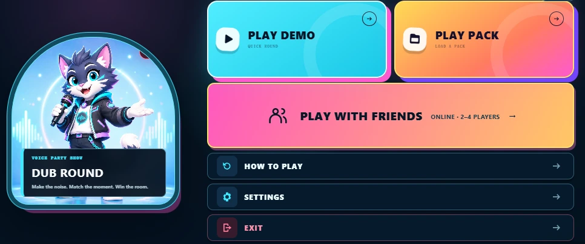
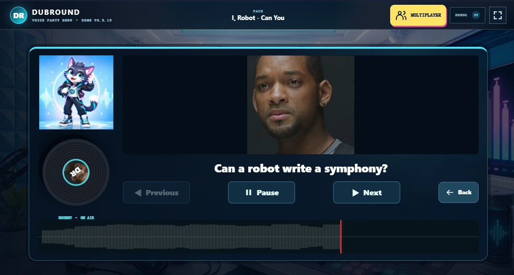
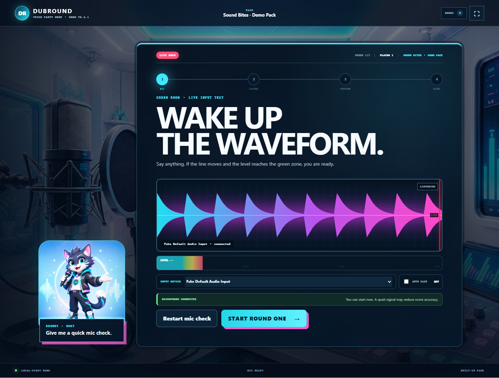

# DubRound — Turn Every Line into Your Voice Challenge

**Official website: [dubround.com](https://dubround.com/)** · [Play Now](https://dubround.com/games/dub-round/) · [Community Packs](https://dubround.com/packs/community/) · [Create a Pack](https://dubround.com/create/from-video/)

DubRound is a browser-based voice game platform where you listen, dub, and compare performances. Pick a familiar line, enable your microphone, and perform your own version: practice solo or take turns challenging friends.

## One Line, Many Ways to Play

- **Instant dubbing**: Listen, record, play back, and compare vocal features such as rhythm. Scores are for entertainment and do not verify identity or dialogue accuracy.
- **Play with friends**: Share a device for a local party. Online rooms support 2–4 players taking turns, matching Packs, and synchronizing scores, with a separate room service required.
- **Community library**: Browse Packs with source attribution, download supported resources, load them into the game, and track actual download and processing status. Upstream resources may change or become unavailable.
- **Custom video Packs**: Split videos you have the right to use into voice clips, preview them, and export a replayable ZIP Pack.
- **Keep your performances**: Basic recording and scoring run locally, with saving and export available. You are responsible for backing up browser data.

## From Listening to Your Own Version

1. Choose a sample or community Pack, or import your own material.
2. Grant microphone access and say a few words to check the input.
3. Listen to the reference clip and record your own performance.
4. Compare performances, try again, or pass the microphone to the next player.

Online rooms synchronize players, rounds, and scores. They do not provide live voice calls or automatically distribute private Pack audio.

## Explore dubround.com

| What You Want to Do | Page |
| --- | --- |
| Play the dubbing game | [DubRound](https://dubround.com/games/dub-round/) |
| Challenge friends | [Multiplayer](https://dubround.com/multiplayer/) |
| Find material | [Community Packs](https://dubround.com/packs/community/) |
| Turn a video into a game | [Pack Creator](https://dubround.com/create/from-video/) |
| Troubleshoot your setup | [Microphone Test](https://dubround.com/tools/mic-test/) |
| Read the policies | [Terms](https://dubround.com/terms/) · [Privacy](https://dubround.com/privacy/) |

## Make Your First Recording Comfortable

A good first challenge is a short line you can hear clearly. Listen once for meaning and again for timing before recording. You do not need to imitate every detail immediately: concentrate on the opening, the pauses, and the final word. Replay your attempt and choose one thing to change. This approach makes a repeated line feel like a small performance exercise rather than a test you must pass.

Use the microphone test page if the game cannot hear you. Confirm that your browser has permission, that the intended input device is selected, and that another application is not using the microphone unexpectedly. Headphones can help keep the reference clip from feeding back into your recording. Find a comfortable volume before beginning a longer session, and stop if speaking repeatedly becomes tiring.

Scores compare aspects of an audio performance for entertainment. They are not a transcript check, a language qualification, or evidence that you sound exactly like another person. A funny interpretation can be worthwhile even when its score is lower. Listen to the actual recording and use your own judgment about expression, clarity, and whether the performance communicates the feeling you intended.

## Choose Material Before Challenging Friends

Community Packs organize reference clips into playable collections. Read the description and source attribution before loading one, especially when playing with younger people or in a shared space. Material from films, games, and online creators can differ substantially in language, loudness, and subject matter. Preview what you can and choose a collection everyone is comfortable hearing.

Downloads depend on the availability of their source. A catalog entry does not guarantee that an upstream file remains accessible forever. Follow the actual status shown by the site, and do not begin a round until the material has finished loading. If a resource is unavailable, choose another Pack rather than repeatedly starting a game with missing audio.

Online play and local turn taking offer different experiences. With one shared device, players can agree on an order and pass the microphone between attempts. For an online room, everyone needs compatible material and a working connection. Room synchronization is not a voice call, so arrange any conversation separately. Private audio is not automatically sent to other players simply because they join a room.

## Create Something You Can Replay

The Pack Creator is intended for video material you have permission to use. Start with a manageable clip, listen to each selected segment, and check that its beginning and end contain the line you want. Short, distinct segments are easier to understand than clips that begin halfway through a sentence or include a long stretch of silence.

Preview your selection before exporting. Give the collection a recognizable name and keep your own copy of the resulting Pack somewhere you can find again. Exporting a file and sharing it are different decisions: only distribute recordings and reference material when you have the necessary permission. Respect the people whose voices appear in your source.

Browser storage is convenient, but it is not a substitute for a personal backup. Clearing site data, switching profiles, or moving to another device can affect locally held recordings. Save anything important before changing your browser setup. The privacy and contact pages provide the appropriate starting points for questions about the website; they do not replace the terms attached to third-party audio.

## Copyright and Contact

Public access to DubRound does not grant permission to redistribute its original code, interface, or branding. Third-party games, Packs, images, and audio belong to their respective rights holders; availability for download does not imply permission to republish. Use the creator only with material you created, licensed, or are otherwise legally allowed to use. Public browser resources cannot be guaranteed to remain impossible to download.

Contact: [mooyuking@gmail.com](mailto:mooyuking@gmail.com) · [dubround.com/contact](https://dubround.com/contact/)
